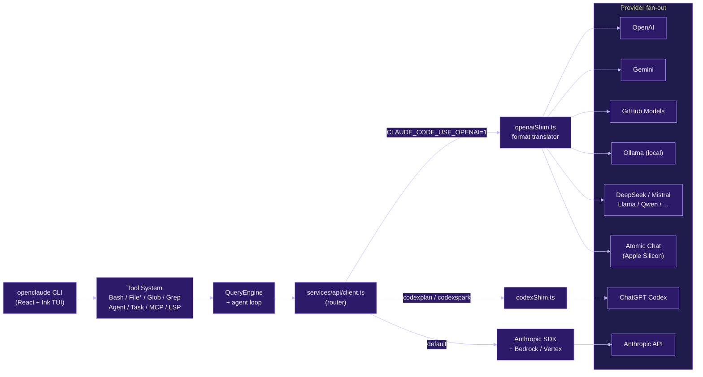

# openpawed

Claude Code opened to any LLM — OpenAI, Gemini, DeepSeek, Ollama, and 200+ models via an OpenAI-compatible API shim.

> Published on npm as `@gitlawb/openclaude`. The CLI binary is `openclaude`.
> This repository is a downstream fork of the Claude Code snapshot exposed via
> npm source maps on 2026-03-31, with added provider shims. Not affiliated
> with or endorsed by Anthropic.

## Table of Contents

- [Overview](#overview)
- [Architecture](#architecture)
- [Quick Start](#quick-start)
- [Development](#development)
- [Testing](#testing)
- [Deployment](#deployment)
- [Sub-Modules](#sub-modules)

## Overview

openpawed keeps the Claude Code tool system (Bash, File*, Glob, Grep, Agent,
Task, MCP, LSP, WebFetch, WebSearch, NotebookEdit, slash commands, memory,
sub-agents, streaming) and swaps the model backend. Instead of only talking
to Anthropic, it can route to:

- **OpenAI** (`gpt-4o`, `gpt-4o-mini`, ...)
- **Google Gemini** (`gemini-2.0-flash`, ...)
- **GitHub Models** (via `GITHUB_TOKEN`)
- **Ollama** (local models, OpenAI-compatible endpoint on `localhost:11434/v1`)
- **DeepSeek, Mistral, Llama, Qwen**, and any other OpenAI-compatible endpoint
- **ChatGPT Codex** backend for `codexplan` / `codexspark`
- **Atomic Chat** for local inference on Apple Silicon
- **Anthropic Bedrock / Vertex** (pass-through to original SDKs)

The shim lives in `src/services/api/openaiShim.ts` and is activated by
`CLAUDE_CODE_USE_OPENAI=1` (or the sibling flags `CLAUDE_CODE_USE_GEMINI`,
`CLAUDE_CODE_USE_GITHUB`, `CLAUDE_CODE_USE_BEDROCK`, `CLAUDE_CODE_USE_VERTEX`).

Not available when routing through the shim: Anthropic extended thinking,
prompt caching, Anthropic beta headers. Native `WebSearch` also requires
Anthropic or the Codex responses endpoint; set `FIRECRAWL_API_KEY` to enable
it for everyone else.

## Architecture



The shim translates Anthropic message blocks to OpenAI messages, Anthropic
`tool_use` / `tool_result` to OpenAI function calls, and OpenAI SSE streams
back to Anthropic stream events. The rest of the CLI never sees the difference.

## Quick Start

```bash
npm install -g @gitlawb/openclaude

# OpenAI
export CLAUDE_CODE_USE_OPENAI=1
export OPENAI_API_KEY=sk-your-key-here
export OPENAI_MODEL=gpt-4o

openclaude
```

Ollama (local, no key):

```bash
export CLAUDE_CODE_USE_OPENAI=1
export OPENAI_BASE_URL=http://localhost:11434/v1
export OPENAI_API_KEY=ollama
export OPENAI_MODEL=llama3.2
openclaude
```

Beginner walkthroughs: `docs/non-technical-setup.md`,
`docs/quick-start-windows.md`, `docs/quick-start-mac-linux.md`.
All env vars: see `.env.example`.

## Development

Requires Node `>=20` and Bun.

```bash
bun install
bun run build            # bundles src/ -> dist/cli.mjs
bun run dev              # build + run dist/cli.mjs
bun run dev:profile      # launch via provider profile
bun run dev:ollama       # launch against local Ollama
bun run typecheck        # tsc --noEmit
bun run doctor:runtime   # runtime health checks
```

Provider profiles are stored in `.openclaude-profile.json` (gitignored).
Initialize one with `bun run profile:init -- --provider ollama --model llama3.1:8b`.

Files that diverge from the upstream Claude Code snapshot:

- `src/services/api/openaiShim.ts` (new)
- `src/services/api/client.ts` (routes to shim)
- `src/utils/model/providers.ts`, `configs.ts`, `model.ts` (new provider type)
- `src/utils/auth.ts` (OpenAI recognized as 3P provider)

## Testing

Tests are colocated as `*.test.ts` / `*.test.mjs` and run with Bun.

```bash
bun run test:provider                 # api + context tests
bun run test:provider-recommendation  # provider profile/recommendation tests
node --test bin/import-specifier.test.mjs
bun run smoke                         # build + --version check
bun run hardening:check               # smoke + doctor:runtime
bun run hardening:strict              # typecheck + hardening:check
```

Python companion scripts at the repo root ship their own pytest files:
`test_smart_router.py`, `test_ollama_provider.py`, `test_atomic_chat_provider.py`.

CI: `.github/workflows/pr-checks.yml`.

## Deployment

There is no cluster deployment. The distributable artifact is the npm package
`@gitlawb/openclaude` (see `package.json` `files` and the `prepack` script).
End users install globally:

```bash
npm install -g @gitlawb/openclaude
```

The VS Code companion extension lives in `vscode-extension/openclaude-vscode/`
and is packaged separately.

## Sub-Modules

- [`bin/`](bin/README.md) — Executable entrypoints shipped in the npm package.
- [`docs/`](docs/README.md) — User-facing setup and quick-start guides.
- [`scripts/`](scripts/README.md) — Build, provider bootstrap, and doctor scripts.
- [`src/`](src/README.md) — TypeScript source for the CLI agent and tool system.
- [`vscode-extension/`](vscode-extension/README.md) — VS Code companion extension.

## License

MIT for the shim additions. The upstream Claude Code source is the property
of Anthropic and is subject to their terms. This repository is provided for
research and educational purposes.
